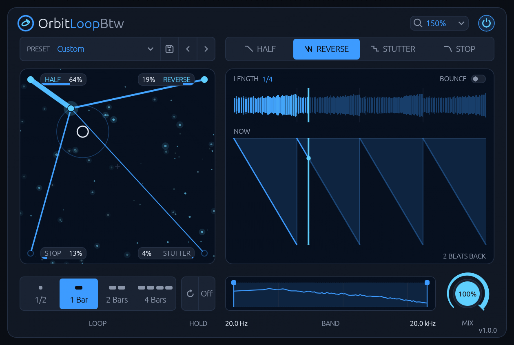

# OrbitLoopBtw

**One loop played four ways at once, half speed, reversed, stuttered and braked like a tape, and
one puck that blends them.** For fills, breakdowns and endings that move with the song. CLAP for
Linux.



**[OrbitLoopBtw on jelly-comet.github.io](https://jelly-comet.github.io/plugins/orbitloopbtw/)**: more screenshots, the manual to read or as a PDF, and every release.

OrbitLoopBtw listens to what plays and loops it four ways at the same time: HALF plays it at half
speed, REVERSE plays each beat backward, STUTTER repeats the end of the loop in ever shorter
slices, and STOP brakes it like a tape machine switched off. Each effect sits in a corner of a pad,
and one puck blends them. Leave the puck in a corner for one effect, put it between corners for a
blend, or throw it and let it orbit, locked to the song, so the effects take turns. Every effect has
its own page, a large display of where its read head goes over the loop. It has no latency: what
isn't being cut plays as it comes in. It is not a sampler or a looper you record into: it always
plays the last loop of what comes in.

**[Read the manual](manual.md)** for every control and how to use it.

## What it's for

- **Fills:** a stutter at the end of the loop, a beat repeat in slices from 1/4 down to 1/64.
- **Transitions and breakdowns:** drop a part to half-time, or play its beats in reverse.
- **Endings:** a tape stop that brakes the music like a tape machine switched off.
- **Glitch effects that move:** throw the puck and half speed, reverse, stutter and tape stop take turns, in time with the song.

## Features

- **Four loop effects at once:** HALF (1.5x, 2x or 4x slower), REVERSE (each 1/16 to 1 bar
  backward, or back and forth), STUTTER (the loop's end repeated in slices of 1/4 to 1/64, even,
  faster or slower, as they are or an octave down or up) and STOP (a tape stop over the loop's end,
  from a pitch glide to a slowing tape).
- **A blend that stays as loud as its corners:** between corners it is within 0.2 LU of the
  corners' own loudness. With the puck in a corner you hear that effect alone, bit for bit.
- **An orbit locked to the song:** throw the puck and it keeps going, round a circle or along a
  line, once in 1/8 to 16 bars. The same bar sounds the same every time, and a render repeats.
- **HOLD:** freezes the loop that just played; all four effects keep playing on it while the dry
  signal stays the song.
- **A band for the effect:** choose the range the effect plays in, 24 dB/octave edges; outside it
  the input passes. Keep the kick and the air, cut up the middle.
- **No latency and no clicks:** joins fade over 2 ms, and a changed setting is heard from the next
  slice, never mid-slice.
- **Presets** of the pad, the orbit, LOOP, every page, the band and MIX: eight built in beside
  Init, from a bar-end roll to a tape ending, and your own.
- **Light:** about 0.8 % of a CPU core at 48 kHz stereo.
- **Zoom** from 100 to 200 %, mono or stereo.
- **No network access and no telemetry.**

## Install

Download the latest version from the [Releases page](https://github.com/jelly-comet/OrbitLoopBtw-release/releases),
or with these commands:

```bash
curl -LO https://github.com/jelly-comet/OrbitLoopBtw-release/releases/download/v1.0.1/OrbitLoopBtw-1.0.1-linux-x86_64.tar.gz
curl -LO https://github.com/jelly-comet/OrbitLoopBtw-release/releases/download/v1.0.1/OrbitLoopBtw-1.0.1-linux-x86_64.tar.gz.sha256
sha256sum -c OrbitLoopBtw-1.0.1-linux-x86_64.tar.gz.sha256 && tar xzf OrbitLoopBtw-1.0.1-linux-x86_64.tar.gz
cd OrbitLoopBtw-1.0.1-linux-x86_64
```

Install for your user:

```bash
mkdir -p ~/.clap
rm -f ~/.clap/OrbitLoopBtw.clap && cp OrbitLoopBtw.clap ~/.clap/
```

Or for all users:

```bash
sudo mkdir -p /usr/lib/clap
sudo rm -f /usr/lib/clap/OrbitLoopBtw.clap && sudo cp OrbitLoopBtw.clap /usr/lib/clap/
```

Removing the old copy first avoids overwriting a file a running host has loaded. Then rescan plugins
in your DAW.

To uninstall:

```bash
rm -f ~/.clap/OrbitLoopBtw.clap
```

Your presets stay in `~/.local/share/OrbitLoopBtw/presets/`; delete that folder too if you want
them gone.

## Requirements

- Linux x86-64 on a CPU with AVX2 (Intel Core from 2013, AMD from 2015), with glibc 2.31 or newer
  (Ubuntu 20.04, Debian 11, Fedora 32 and newer)
- A CLAP host. Tried in Bitwig Studio and REAPER.
- X11 or XWayland, and a Vulkan driver for the editor

Releases contain the CLAP plugin only.

## License

MIT, see [LICENSE](LICENSE). The licenses of the third-party code in the binaries are in
`THIRD-PARTY-LICENSES.txt` in each release archive.

CLAP is an open standard by the free-audio project. OrbitLoopBtw is an independent project, not
affiliated with or endorsed by the makers of any other loop or stutter effect.
