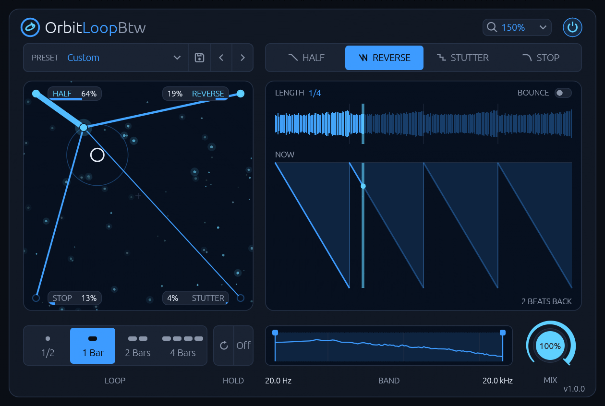
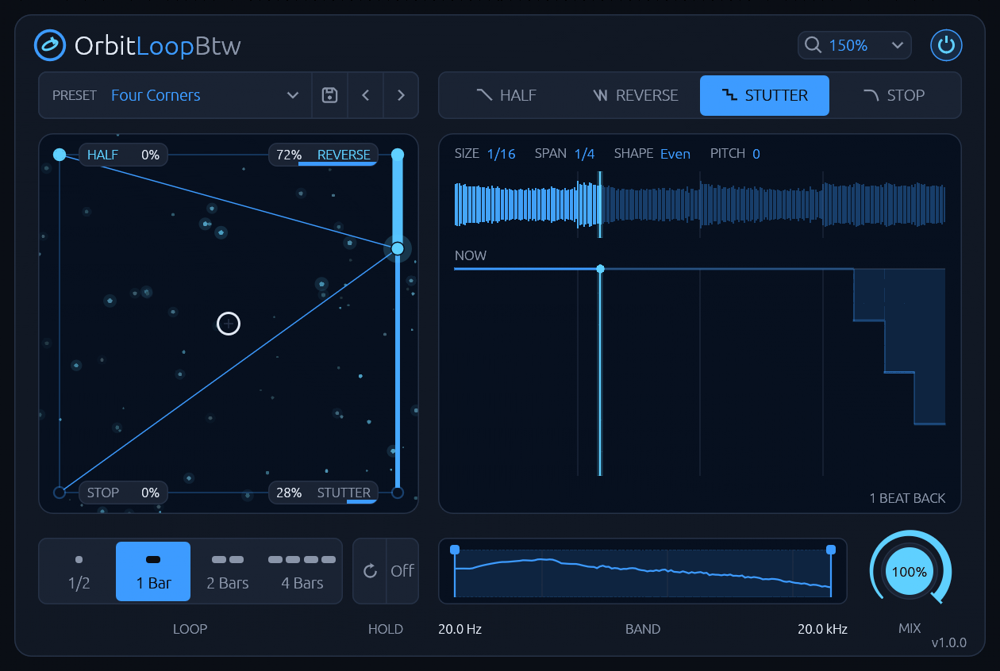
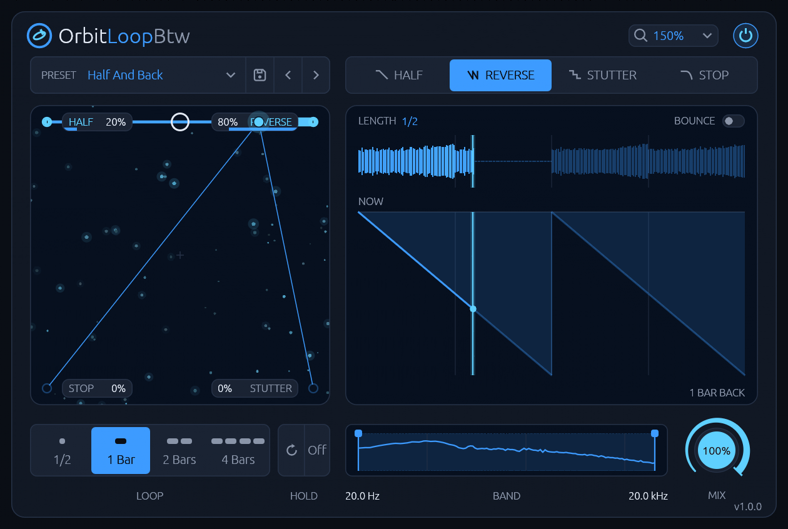
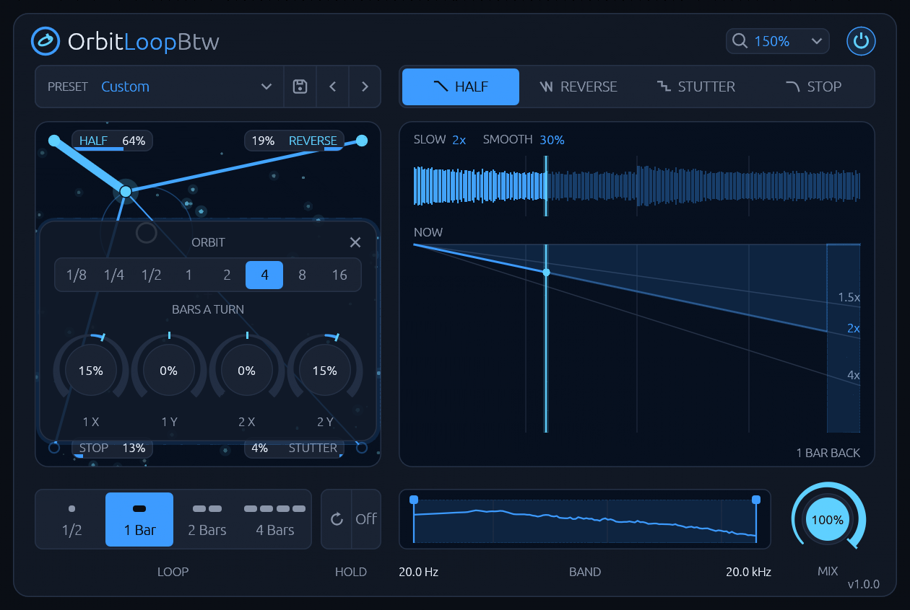
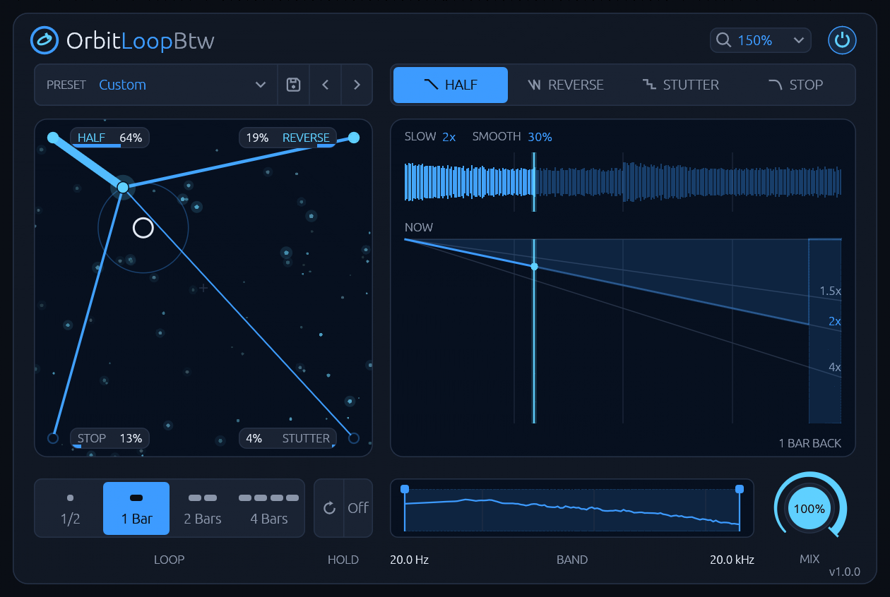
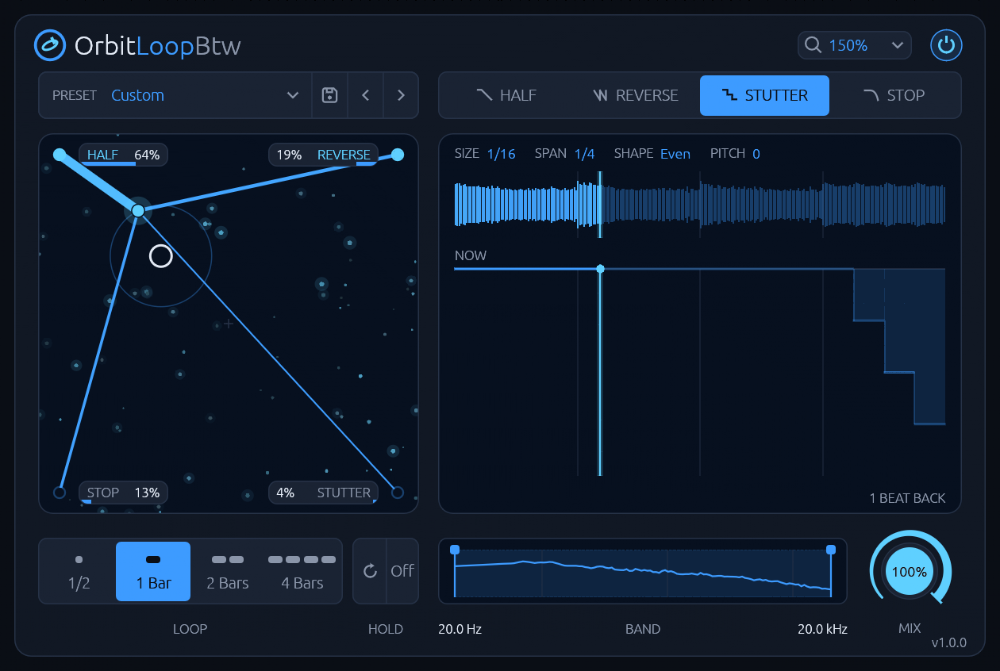
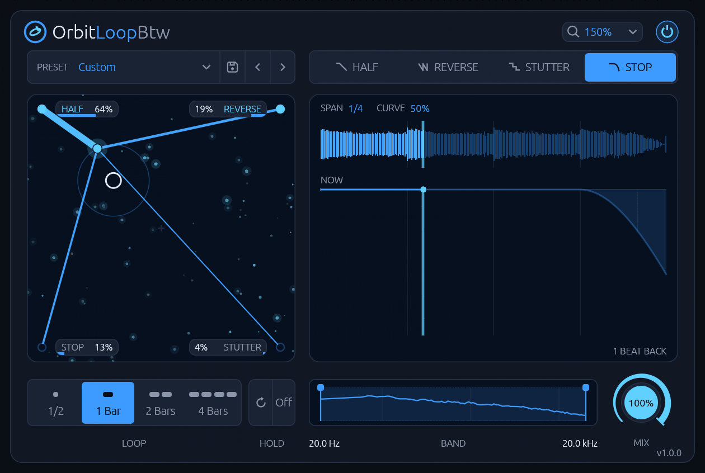

# OrbitLoopBtw manual

**One loop played four ways at once, half speed, reversed, stuttered and braked like a tape, and
one puck that blends them.**

Version 1.0.0. To install it, see the [README](README.md).

## Contents

- [Getting started](#getting-started)
- [The controls](#the-controls)
- [How to use it](#how-to-use-it)
  - [The pad and the orbit](#the-pad-and-the-orbit)
  - [The pages](#the-pages)
  - [LOOP and HOLD](#loop-and-hold)
  - [The band and MIX](#the-band-and-mix)
  - [Presets](#presets)
- [Good to know](#good-to-know)
- [Troubleshooting](#troubleshooting)

## Getting started

Put OrbitLoopBtw on a drum bus, a vocal or a whole mix and press play in your DAW. A new instance
has the puck in the HALF corner, so you hear the last bar played at half speed, starting on every
bar line. Now drag the puck towards REVERSE: the beats come backward, and between the two you hear
both, as loud as either alone.

For the quickest idea of what it does, open the PRESET list and pick **Four Corners**: the puck
goes round the pad once in four bars, a bar in each corner.



## The controls

From the top of the window.

| Control | Range | Default | What it does |
| --- | --- | --- | --- |
| **Power switch** (header) | On / Off | On | Off fades to the dry input over 20 ms. The loops keep running, so switching on needs no warm-up. |
| **Zoom** (header) | 100 to 200 % | 100 % | The window's size, kept with the project. |
| **PRESET** (top row) | Init, eight built in, your own | Init | Sets the pad, the orbit, LOOP, every page, the band and MIX at once; the disk saves them under a name. |
| **Pages** (top row) | HALF, REVERSE, STUTTER, STOP | HALF | Which effect the display shows. Only a view: it doesn't follow the puck. |
| **The pad** | the four corners | on HALF | The blend: each corner's chip shows its share and lights while that corner is cutting. |
| **Orbit** (throw the puck) | two radii, −100 to 100 % of the pad | none | Where the puck travels round the place you set. |
| **ORBIT** (right-click the pad) | 1/8, 1/4, 1/2, 1 Bar, 2, 4, 8, 16 Bars | 4 Bars | How long the orbit takes to go round once. |
| **LOOP** | 1/2, 1 Bar, 2 Bars, 4 Bars | 1 Bar | The loop all four effects play over. |
| **HOLD** | On / Off | Off | The last loop goes round in place of the input, and the effects play on it. |
| **SLOW** (HALF) | 1.5x, 2x, 4x | 2x | How much slower HALF plays. |
| **SMOOTH** (HALF) | 0 to 100 % | 30 % | HALF's fade back to the present at the loop's end, up to a quarter of the loop. |
| **LENGTH** (REVERSE) | 1/16, 1/8, 1/4, 1/2, 1 Bar | 1/4 | How much plays backward at a time; at most the loop. |
| **BOUNCE** (REVERSE) | On / Off | Off | Backward, then forward again, over twice LENGTH. |
| **SIZE** (STUTTER) | 1/4, 1/8, 1/8T, 1/16, 1/16T, 1/32, 1/64 | 1/16 | The slice that repeats. |
| **SPAN** (STUTTER) | 1/8, 1/4, 1/2, All of the loop | 1/4 | How much of the loop's end stutters. |
| **SHAPE** (STUTTER) | Even, Faster, Slower | Even | Slices of one size, or each 0.75 or 1.33 times the one before. |
| **PITCH** (STUTTER) | −12, 0, +12 | 0 | The repeats an octave down or up. The first slice stays the input. |
| **SPAN** (STOP) | 1/8, 1/4, 1/2, All of the loop | 1/4 | How much of the loop's end brakes. |
| **CURVE** (STOP) | 0 to 100 % | 50 % | From a straight fall in speed to a slowing tape. |
| **BAND** (Band Low, Band High) | 20 Hz to 20 kHz | open | The range the effect plays in; outside it the dry input passes. An edge at its end is off. |
| **MIX** | 0 to 100 % | 100 % | How much of the effect is heard inside the band; 0 % is the dry input. |

## How to use it

### The pad and the orbit

Each corner is one effect: HALF at the top left, REVERSE at the top right, STUTTER at the bottom
right, STOP at the bottom left. Where the puck is decides how much of each you hear, and each
corner's chip shows its share as a bar.

- **Drag the puck** to blend. Click a corner's chip for all of that corner; double-click the pad to
  reset the puck.
- **Throw it:** let go while it moves and it keeps going, round a circle or along a line through
  the place you let go. Press to catch it. Right-click the pad for the orbit panel: ORBIT (how many
  bars one round takes) and four knobs for the orbit's two radii.
- The orbit's place comes from the song position, so the same bar sounds the same every time you
  play it, and a bounce matches what you heard. With the transport stopped it runs on at the
  host's tempo.

| | |
| --- | --- |
|  |  |
| Four Corners: both radii at 50 %, a round through every corner in four bars | Half And Back: one radius only, a line along the top between HALF and REVERSE |



The orbit is two radii, each a sideways (X) and an up-and-down (Y) part, from −100 to 100 % of the
pad. One radius alone draws a line through the puck's place; two at right angles draw a circle or
an ellipse; two that lean the same way a tilted ellipse. A negative value turns that radius round:
on the first, the puck starts its round on the other side; on the second, it goes round the other
way. Throwing the puck sets them for you; the panel sets them exactly.

Corners that are playing the input at a given moment count as one voice, and the voices add by
equal power, so a blend stays about as loud as its corners. Four different signals can still peak a
few dB over the input in the pad's middle; there is no limiter after it.

A corner's pin and name light while that effect is actually cutting: STUTTER and STOP play the
plain input for most of the loop, and the light shows when they take over.

### The pages

The page buttons choose which effect the big display shows: where that corner's read head goes
over the loop. Its settings are in the row at the display's top: drag a value up or down (Shift for
finer steps), click a stepped one for its list, turn the wheel over it, double-click to reset;
BOUNCE is a switch. A changed setting is heard from the next slice, never in the middle of one.

- **HALF** starts on the loop's line and plays at SLOW's speed, then fades back to the present
  over SMOOTH before the next line. 2x is the classic half-time; 4x a deep drag.
- **REVERSE** plays each LENGTH backward from its end. 1/4 reverses each beat; 1 Bar the whole
  bar. BOUNCE plays each piece backward then forward again.
- **STUTTER** plays the input, then repeats one slice over the loop's last SPAN. Faster makes each
  slice shorter than the one before, the classic build into a drop; Slower the other way. PITCH
  plays the repeats an octave down or up.
- **STOP** plays the input, then brakes over the last SPAN until the tape stands still. CURVE 0 %
  slows down evenly, like a pitch glide; 100 % holds on longer and then sinks, like a tape machine.

| | |
| --- | --- |
|  |  |
| HALF at its defaults: the bar read at half speed, the faint lines 1.5x and 4x | REVERSE at its defaults: each beat backward from its end |
|  |  |
| STUTTER at its defaults: the loop's last quarter repeated in 16ths | STOP at its defaults: a tape stop over the loop's last quarter |

### LOOP and HOLD

LOOP is how long the loop is that all four corners play over, from half a bar to four bars. A
corner takes a new LOOP at its next slice, so changing it never cuts a slice short.

HOLD freezes the last loop: it goes round in place of the input, the same every time, and all four
effects keep playing on it, while the dry signal (outside the band, or with MIX below 100 %) stays
the song. Use it for an ending, or a bar that won't let go. It holds the last loop from the moment
you press it, so press on a bar line for a loop that starts on one. It needs a whole loop to have
come in first, up to four bars with LOOP at 4 Bars. Letting go fades back to the input.

### The band and MIX

BAND, under the display, shows the effect's spectrum and selects where the effect plays: drag its edges, or the band between them
to move it whole; double-click an edge to reset it, or the band to reset both. Outside the band you
hear the dry input; inside it the effect, mixed with the dry input by MIX. With the band set on the
middle, the kick and the cymbals keep playing straight while the rest is cut up (the **Band Chop**
preset).

While an edge is set, the dry input keeps its level at every frequency but not its exact phase, so
it may sound slightly different from the plugin switched off. With the band open and MIX at 100 %
you hear the effect alone.

### Presets

Choose one in the PRESET list or step with the arrows. A preset sets the pad, the orbit, LOOP,
every page, the band and MIX; it leaves the power switch and HOLD where they are, so you can change
presets while holding a loop.

Built in beside Init:

| Preset | What it does |
| --- | --- |
| **Bar-End Roll** | The last beat of every bar rolls in, faster and faster. |
| **Octave Roll** | The same roll an octave up, every second bar. |
| **Tape Ending** | The fourth bar winds down like a tape. |
| **Four Corners** | Round the pad once in four bars, a bar in each corner: HALF, REVERSE, STUTTER, STOP. |
| **Half And Back** | Half speed on the first bar, backward on the second. |
| **Band Chop** | Only the middle is cut up: the kick and the air pass. |
| **Bounce Under** | Each half bar backward and forward again, under the dry signal. |
| **Slow Swirl** | A small, slow circle near HALF, eight bars round, that only brushes the others. |

The disk saves the current settings under a name; Enter saves. In the list your favourites come
first, with a star, and the bin deletes one of yours. Presets are small text files in
`~/.local/share/OrbitLoopBtw/presets/`, shared by every project, one `id value` line a setting:

```text
blend_x 0.25
loop 2
half_slow x2
reverse_bounce off
```

A line a file doesn't have leaves its setting alone, so a preset can set only a few things.

## Good to know

- **Latency:** none. What isn't being cut plays as it comes in.
- **Time:** a bar is four quarter notes, whatever the host's time signature, so in 3/4 the loop
  runs across the bar lines.
- **Automation:** every control can be automated, the pad's two values and the orbit's radii too.
- **Saved with the project:** every setting, the page shown and the zoom.
- **CPU:** about 0.8 % of a core at 48 kHz stereo; RAM about 8 MB an instance at 48 kHz (a 20 s
  buffer).
- **Mono or stereo,** at any sample rate.
- **Hosts:** the CLAP passes `clap-validator`, and REAPER renders it the same every time at any
  block size. Some hosts keep keystrokes for themselves; then a preset can't be named in the
  editor (write the file by hand).
- **Display:** X11, or XWayland on a Wayland desktop, with a Vulkan driver.

## Troubleshooting

- **A setting changes a moment later:** a page setting is heard from the next slice, and a new
  LOOP from each corner's next slice, up to a whole loop later. Nothing is cut mid-slice.
- **The puck in the middle is louder at the peaks:** four different signals can peak a few dB over
  the input. Lower MIX or the track's level if it clips.
- **HOLD does nothing at first:** it waits until a whole loop has come in.
- **A held loop's join is in the middle of the bar:** it holds the last loop from where you
  pressed. Press on the bar line.
- **It keeps moving with the transport stopped:** the loop and the orbit run on at the host's tempo
  while the host keeps the plugin running.
- **Typing a preset's name does nothing:** the host keeps the keystrokes. Write the preset file by
  hand.
- **A preset doesn't show up:** its file must end in `.preset` and can't have a built-in preset's
  name. The list is read when the editor opens and after a save.
- **The window stays black:** the editor needs a Vulkan driver (`vulkaninfo` should list your
  GPU).
- **It doesn't load:** the plugin needs a CPU with SSE4.1 and glibc 2.31 or newer.
